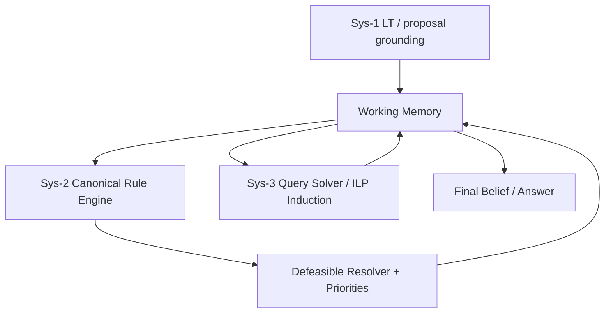

# Feasibility of LT/ILP vs Meta-Rule-First Bootstrapping for GSM8K (Low-Compute AGI Strategy)

## User Question

Researching: I want to research more on the feasibility of machine learning (either with LT or ILP) to solve the GSM8K dataset. Previously we have spent ample time on hand-crafted logic rules in Sys-2 and the progress was strong and steady, albeit that was not truly ML. It is not imperative for us to use ML to solve GSM8K, or even for bootstrapping an AGI. I was exploring the possibility of injecting meta-rules into Sys-2 or 3 such that the whole system can learn rules on its own by reading texts and from human interaction in NL. With this method, the entire paradigm of traditional ML (LT or ILP) may be scrapped. Is that plausible? I am not obsessed with using ML; our priority should be to minimize the time to bootstrap AGI and minimize the use of computing power.

## Executive Summary

Your core intuition is sound: in the current repository state, **pure LT-only or ILP-only is unlikely to solve GSM8K to a significant degree** without substantial additional work in parsing, numeric grounding, and evaluation rigor.[^1][^2] At the same time, the codebase already contains strong symbolic infrastructure (Sys-2 canonical + defeasible, WM temporal/finality logic, Sys-3 induced-rule injection) that supports a **symbolic-first bootstrap path with much lower compute cost**.[^3][^4][^5]  

So, scrapping traditional heavy ML entirely is **partially plausible** for near-term AGI bootstrapping if scope is constrained: use meta-rules + human-in-the-loop rule teaching + strict symbolic validation, while retaining only lightweight ML for grounding/proposal ranking where it measurably helps.[^6][^7][^8]  

The recommended strategy is **Hybrid Symbolic-First (Option B)**: prioritize symbolic/meta-rule progress now, gate ML continuation by hard outcome thresholds, and kill ML-heavy tracks if they fail to beat symbolic baseline under compute constraints.[^9][^10]

## Query Type

**Type 3 (Technical Deep-dive)** with strategic decision framing.

## Key Repositories Summary

| Repository | Relevance |
|---|---|
| [Cybernetic1/AGI-prototype](https://github.com/Cybernetic1/AGI-prototype) | Contains all evidence: LT, ILP, Sys-2 defeasible logic, Sys-3 induction, WM, and benchmark scripts/artifacts |

Indexed commit SHA reported repeatedly by search agents: **`2fadf733788dfe6544c6e3f1539539c217df511f`**.[^11]

## Architecture Reality Check

- Sys-2 canonical and defeasible stages are already integrated in the cognitive loop.[^3][^4]  
- Sys-3 can induce rules on failure and re-inject them as `Inducedrule` WM nodes at runtime.[^5]  
- WM already supports state/finality and contradiction handling primitives needed for symbolic chaining.[^12]

## Feasibility Findings

## 1) LT-only for GSM8K (current state): **Not yet feasible enough**

- LT scripts and objectives exist, but committed evidence is mostly smoke/slice-level and mixed metrics; broad authoritative end-to-end GSM8K success is not demonstrated in-repo.[^1][^13]  
- Preprocessing remains heuristic in key places (operation detection, proposition extraction), which limits robust transfer across GSM8K diversity.[^14]

**Conclusion:** LT is useful as a grounding/proposal module, but not yet a reliable stand-alone GSM8K solver in this codebase.

## 2) ILP-only for GSM8K (current state): **Not yet feasible enough**

- Current ILP pipeline mainly learns class-like symbolic mappings over LT exports, not full arithmetic QA.[^2]  
- Several sweep metrics saturate (e.g., 1.0 coverage/F1 in certain setups), signaling limited diagnostic power for deep compositional reasoning readiness.[^15][^16]

**Conclusion:** ILP is promising and compute-efficient for structured symbolic subproblems, but currently insufficient alone for strong GSM8K solving.

## 3) Meta-rule-first + human NL interaction path: **Plausible in constrained form**

- NL rule injection exists and works, but is intentionally narrow (template/keyword families), with limited governance and no full dynamic activation pipeline equivalent to mature production rule lifecycle.[^6][^7]  
- Defeasible conflict governance is robust enough to serve as safety layer once rule lifecycle/approval/persistence is strengthened.[^4]

**Conclusion:** A constrained “teachable symbolic system” is plausible now; fully free-form NL rule learning is not yet.

## Strategic Options (Time-to-Bootstrap + Compute Minimization)

| Option | Compute | Near-term progress speed | GSM8K upside now | Risk |
|---|---:|---:|---:|---|
| A) ML-heavy (scale LT/ILP training) | High | Medium | Medium | High compute + uncertain near-term uplift |
| B) Hybrid symbolic-first + selective ML | Low–Medium | **High** | Medium-High | Moderate |
| C) Mostly meta-rules + human interaction (minimal ML) | Low | Medium-High (narrow scope) | Medium (bounded) | Coverage ceiling risk |

Recommendation from evidence: **B first, C as support, A only behind gates**.[^9][^10]

## What “Scrap ML” Can Realistically Mean Here

A practical interpretation is:
1. Keep Sys-2/Sys-3 symbolic reasoning authoritative.
2. Use NL/meta-rule teaching for narrow families.
3. Retain only lightweight ML components if they pass objective uplift tests.

This satisfies your priorities (fast bootstrap, low compute) better than broad neural scaling right now.[^8][^10]

## Low-Compute Roadmap (Pragmatic)

### Phase 1 (Immediate: 0–7 days)
- Lock symbolic baselines on family/finality/template tests and treat as non-regression contract.[^8]  
- Make Sys-1 proposal-only mode explicit; Sys-2/3 remains authority.[^3]

### Phase 2 (1–3 weeks)
- Expand one symbolic family at a time (not broad sweeps).  
- Strengthen NL rule lifecycle: approval states, persistence, rollback, and regression checks around injected rules.[^6][^7]

### Phase 3 (3–6 weeks)
- Run ML only as selective ablation against symbolic baseline; stop if no measurable uplift.  
- If uplift appears only in narrow grounding tasks, keep ML minimal and scoped.

## Decision Gates and Kill Criteria

Continue ML investment only if all hold:
1. ML-proposal ON improves solved-rate by meaningful margin over symbolic baseline (or reduces null answers) on the same benchmark slice.[^8]  
2. No regression in symbolic invariants/finality correctness.[^8][^12]  
3. Compute budget remains bounded (avoid broad expensive sweeps without clear gain).[^10]

Kill/freeze ML-heavy track if:
- two consecutive checkpoints show no uplift vs symbolic baseline, or  
- symbolic correctness regresses, or  
- compute cost rises without corresponding quality gain.

## Concrete Missing Pieces for Meta-Rule-Centric Path

**Must-have**
1. Durable rule registry (versioning/status/evidence), not WM-only transient insertion.[^7]  
2. Approval/activation workflow (proposed→approved→active→retracted).  
3. Stronger semantic validation for NL-injected rules beyond schema/family checks.[^6]

**Nice-to-have**
- Auto-generated counterexamples/regression tests per new rule family.  
- Priority auto-tuning in defeasible layer based on observed conflict outcomes.[^4]

## Confidence Assessment

**Certain (high confidence)**
- Current LT-only and ILP-only paths are not yet sufficient for strong GSM8K performance in this repo state.[^1][^2][^15]  
- Symbolic infrastructure is already mature enough to drive low-compute progress now.[^3][^4][^5][^12]

**Likely (medium confidence)**
- Hybrid symbolic-first with selective ML will minimize compute and maximize near-term bootstrap speed vs ML-heavy strategy.[^9][^10]

**Assumptions**
- “Bootstrap AGI” here means maximizing reliable capability growth under strict compute constraints, not immediate SOTA GSM8K.
- Decisions should be made from existing repository evidence and current architecture intent at commit `2fadf733...`.

---

## Footnotes

[^1]: [logic_transformer/run_gsm8k_eval.py:14-42](https://github.com/Cybernetic1/AGI-prototype/blob/2fadf733788dfe6544c6e3f1539539c217df511f/logic_transformer/run_gsm8k_eval.py#L14-L42), [logic_transformer/run_gsm8k_math_score.py:31-69](https://github.com/Cybernetic1/AGI-prototype/blob/2fadf733788dfe6544c6e3f1539539c217df511f/logic_transformer/run_gsm8k_math_score.py#L31-L69), [GSM8K-mock-success.txt:1-5](https://github.com/Cybernetic1/AGI-prototype/blob/2fadf733788dfe6544c6e3f1539539c217df511f/GSM8K-mock-success.txt#L1-L5)
[^2]: [ilp_learner/generate_and_run_gsm8k_ilp.py:1-109](https://github.com/Cybernetic1/AGI-prototype/blob/2fadf733788dfe6544c6e3f1539539c217df511f/ilp_learner/generate_and_run_gsm8k_ilp.py#L1-L109), [forward_engine/phase3_synthetic_test.py:25-64](https://github.com/Cybernetic1/AGI-prototype/blob/2fadf733788dfe6544c6e3f1539539c217df511f/forward_engine/phase3_synthetic_test.py#L25-L64)
[^3]: [cognitive_loop.py:309-361](https://github.com/Cybernetic1/AGI-prototype/blob/2fadf733788dfe6544c6e3f1539539c217df511f/cognitive_loop.py#L309-L361)
[^4]: [forward_engine/defeasible_logic.py:174-238](https://github.com/Cybernetic1/AGI-prototype/blob/2fadf733788dfe6544c6e3f1539539c217df511f/forward_engine/defeasible_logic.py#L174-L238), [rules/defeasible_rule_kb.yaml:1-19](https://github.com/Cybernetic1/AGI-prototype/blob/2fadf733788dfe6544c6e3f1539539c217df511f/rules/defeasible_rule_kb.yaml#L1-L19)
[^5]: [cognitive_loop.py:731-781](https://github.com/Cybernetic1/AGI-prototype/blob/2fadf733788dfe6544c6e3f1539539c217df511f/cognitive_loop.py#L731-L781)
[^6]: [working_memory/nl_rule_injection.py:40-45](https://github.com/Cybernetic1/AGI-prototype/blob/2fadf733788dfe6544c6e3f1539539c217df511f/working_memory/nl_rule_injection.py#L40-L45), [working_memory/nl_rule_injection.py:52-126](https://github.com/Cybernetic1/AGI-prototype/blob/2fadf733788dfe6544c6e3f1539539c217df511f/working_memory/nl_rule_injection.py#L52-L126)
[^7]: [working_memory/working_memory.py:625-687](https://github.com/Cybernetic1/AGI-prototype/blob/2fadf733788dfe6544c6e3f1539539c217df511f/working_memory/working_memory.py#L625-L687), [rules/print_rules.py:92-103](https://github.com/Cybernetic1/AGI-prototype/blob/2fadf733788dfe6544c6e3f1539539c217df511f/rules/print_rules.py#L92-L103)
[^8]: [cognitive_loop.py:2215-2467](https://github.com/Cybernetic1/AGI-prototype/blob/2fadf733788dfe6544c6e3f1539539c217df511f/cognitive_loop.py#L2215-L2467), [plan.md:1-37](https://github.com/Cybernetic1/AGI-prototype/blob/2fadf733788dfe6544c6e3f1539539c217df511f/plan.md#L1-L37)
[^9]: [AGI-development-plan.md:7-25](https://github.com/Cybernetic1/AGI-prototype/blob/2fadf733788dfe6544c6e3f1539539c217df511f/AGI-development-plan.md#L7-L25), [AGI-development-plan.md:49-89](https://github.com/Cybernetic1/AGI-prototype/blob/2fadf733788dfe6544c6e3f1539539c217df511f/AGI-development-plan.md#L49-L89)
[^10]: [plan.md:95-129](https://github.com/Cybernetic1/AGI-prototype/blob/2fadf733788dfe6544c6e3f1539539c217df511f/plan.md#L95-L129), [ilp_learner/hyperparam_sweep_results.json:1-13](https://github.com/Cybernetic1/AGI-prototype/blob/2fadf733788dfe6544c6e3f1539539c217df511f/ilp_learner/hyperparam_sweep_results.json#L1-L13)
[^11]: semantic_code_search indexed commit reported by research subagents: `2fadf733788dfe6544c6e3f1539539c217df511f`
[^12]: [working_memory/working_memory.py:139-217](https://github.com/Cybernetic1/AGI-prototype/blob/2fadf733788dfe6544c6e3f1539539c217df511f/working_memory/working_memory.py#L139-L217), [working_memory/working_memory.py:283-571](https://github.com/Cybernetic1/AGI-prototype/blob/2fadf733788dfe6544c6e3f1539539c217df511f/working_memory/working_memory.py#L283-L571)
[^13]: [logic_transformer/eval.py:176-185](https://github.com/Cybernetic1/AGI-prototype/blob/2fadf733788dfe6544c6e3f1539539c217df511f/logic_transformer/eval.py#L176-L185), [logic_transformer/train.py:237-272](https://github.com/Cybernetic1/AGI-prototype/blob/2fadf733788dfe6544c6e3f1539539c217df511f/logic_transformer/train.py#L237-L272)
[^14]: [logic_transformer/preprocess_gsm8k.py:8-43](https://github.com/Cybernetic1/AGI-prototype/blob/2fadf733788dfe6544c6e3f1539539c217df511f/logic_transformer/preprocess_gsm8k.py#L8-L43), [logic_transformer/preprocess_gsm8k.py:45-120](https://github.com/Cybernetic1/AGI-prototype/blob/2fadf733788dfe6544c6e3f1539539c217df511f/logic_transformer/preprocess_gsm8k.py#L45-L120)
[^15]: [ilp_learner/hyperparam_sweep_results.json:8-13](https://github.com/Cybernetic1/AGI-prototype/blob/2fadf733788dfe6544c6e3f1539539c217df511f/ilp_learner/hyperparam_sweep_results.json#L8-L13)
[^16]: [ilp_learner/hyperparam_sweep_with_neg_results.json:359-364](https://github.com/Cybernetic1/AGI-prototype/blob/2fadf733788dfe6544c6e3f1539539c217df511f/ilp_learner/hyperparam_sweep_with_neg_results.json#L359-L364), [ilp_learner/hyperparam_sweep_hard_neg_results.json:401-406](https://github.com/Cybernetic1/AGI-prototype/blob/2fadf733788dfe6544c6e3f1539539c217df511f/ilp_learner/hyperparam_sweep_hard_neg_results.json#L401-L406)

