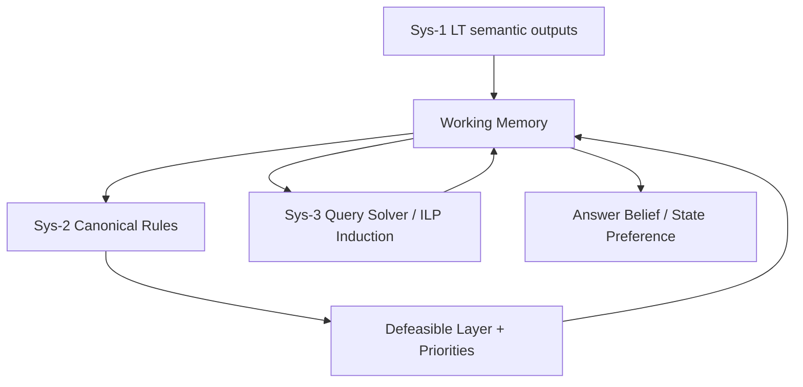

# Narrowing the LT↔Sys-2 Learnability Gap for Defeasible Reasoning

## Executive Summary

Your concern is valid: the current gap is mostly **structural**, not just data-related. Sys-2’s answer-critical logic uses long conjunctive joins (often 8 conditions), while current LT/ILP paths are biased toward short local patterns (typically 2-body rules), so they optimize different hypothesis spaces.[^1][^2][^3]  

The good news is the repository already has most of the required scaffolding: tri-system orchestration, WM state abstraction (`StateTransition`, `Before`, `FinalState`), defeasible priority resolution, and Sys-3 induced-rule reinjection.[^4][^5][^6][^7] The fastest path is to **decompose one long Sys-2 rule family into a chain of 2-conj micro-rules** and run a small Bob-apples bridge demo through existing hooks.  

Current ILP sweeps are not yet diagnostic for this gap (many saturated metrics), so they should be treated as sanity checks rather than proof of compositional rule learning capacity.[^8][^9][^10]  

## Query Type

**Type 3: Technical deep-dive** (implementation/architecture gap, code-level bridge plan).

## Key Repositories Summary

| Repository | Role in this question | Why it matters |
|---|---|---|
| [Cybernetic1/AGI-prototype](https://github.com/Cybernetic1/AGI-prototype) | Primary implementation | Contains LT, Sys-2 canonical/defeasible logic, Sys-3/ILP, and orchestration layers |

## Architecture Overview (current)

- Sys-1 emits semantic WMEs from LT outputs.[^11]  
- Sys-2 runs canonical rule application and then defeasible conflict resolution.[^12][^13]  
- Sys-3 selects/solves queries, and on failure can induce `Inducedrule` and inject it back to WM.[^7]  

## Where the Gap Actually Is

### 1) Sys-2 rule complexity is genuinely high in critical paths
Both canonical and defeasible KBs include key `remaining_quantity` logic with **~8 conjuncts**, joining state facts + query facts + owner/item co-reference.[^1][^2]

### 2) LT/ILP active learning loops are short-form today
- LT is commonly instantiated with `num_premises=2` in active demos/training paths (though architecture is parameterized).[^3][^14]  
- Current ILP learner actively uses a minimal 2-body metarule family in search, with early stopping and limited structural expansion.[^15]

### 3) Why current metrics can look “too good”
Some ILP sweeps show saturated coverage/F1 or constant artifacts due to task setup/negative construction, so they do not yet establish robust long-chain reasoning transfer.[^8][^9][^10]

## Concrete Bridge Design (minimal demo)

### Before (monolithic long rule)
The current long form (representative):

`state(s1) ∧ owner(s1,X) ∧ item(s1,Y) ∧ after(s1,Q) ∧ query(q1) ∧ owner(q1,X) ∧ item(q1,Y) ∧ goal(q1,remaining_quantity) -> belief(answer,Q)`[^1]

### After (2-conj micro-rule chain)
Decompose into short, learnable pieces:
1. `state(S) ∧ owner(S,X) -> state_owner(S,X)`
2. `state(S) ∧ item(S,Y) -> state_item(S,Y)`
3. `state(S) ∧ after(S,Q) -> state_after(S,Q)`
4. `query(Q1) ∧ goal(Q1,remaining_quantity) -> remaining_query(Q1)`
5. `query(Q1) ∧ owner(Q1,X) -> query_owner(Q1,X)`
6. `query(Q1) ∧ item(Q1,Y) -> query_item(Q1,Y)`
7. `state_owner(S,X) ∧ query_owner(Q1,X) -> owner_match(S,Q1)`
8. `state_item(S,Y) ∧ query_item(Q1,Y) -> item_match(S,Q1)`
9. `owner_match(S,Q1) ∧ item_match(S,Q1) -> state_query_match(S,Q1)`
10. `state_query_match(S,Q1) ∧ state_after(S,Q) -> answer_for_query(Q1,Q)`
11. `remaining_query(Q1) ∧ answer_for_query(Q1,Q) -> belief(answer,Q)`

This aligns with the repo’s existing reified, arity-limited style and keeps each learning step local.[^16][^17]

## Component-Level Recommendations

### A) Sys-2 decomposition first (highest ROI)
- Add micro-rules next to existing long rule family in `rules/sys2_rule_kb.yaml`.[^1]  
- In `canonical_system2.py`, add a generic 2-body matcher loop (keep existing transition special-case), then evaluate side-by-side with current shortcut path.[^18]

### B) Keep defeasible layer as safety net
- Preserve strict/defeasible priority policy; use it to adjudicate stale vs final-state evidence in chain outputs.[^2][^13]

### C) Use Sys-3 induction to fill missing links
- Keep online induced-rule path enabled for bridge predicates that fail initially, then promote stable patterns into Sys-2 templates.[^7][^19]

### D) Treat current ILP sweeps as baseline sanity only
- Expand metarule richness + discriminative negatives before drawing conclusions about long-chain learnability.[^15][^8][^9]

## Minimal Experiment Plan (1–2 day “simple demo”)

1. Implement micro-rule chain for one family: `remaining_quantity`.
2. Run Bob-apples trace through LT→WM→Sys-2(decomposed)→defeasible; confirm final `belief(answer,7)` path.
3. Compare against current monolithic rule:
   - chain completion rate,
   - contradiction count,
   - defeasible override correctness on blocked-state conflict cases.
4. Optional: enable Sys-3 induced-rule capture for failed links and observe whether repeated runs reduce fallback frequency.

## Confidence Assessment

**Certain**
- Sys-2 includes 8-conjunct answer-critical rules in both canonical/defeasible KBs.[^1][^2]  
- Current LT/ILP active paths are structurally short-form compared to those long joins.[^3][^14][^15]  
- Orchestrator + WM + defeasible + induced-rule plumbing needed for a bridge demo already exist.[^4][^5][^6][^7][^12][^13]

**Inferred (but strongly grounded)**
- Decomposition into 2-conj bridge predicates is the fastest way to reduce hypothesis-space mismatch without major architecture changes.  
- Current sweep saturation likely reflects evaluation design limits, not solved compositional reasoning.

**Assumptions**
- The goal is near-term practical narrowing of the LT↔Sys-2 gap (not full redesign).  
- Existing indexed commit reflects the working state for this research (`2fadf733788dfe6544c6e3f1539539c217df511f`).

---

## Footnotes

[^1]: [rules/sys2_rule_kb.yaml:25-31](https://github.com/Cybernetic1/AGI-prototype/blob/2fadf733788dfe6544c6e3f1539539c217df511f/rules/sys2_rule_kb.yaml#L25-L31)
[^2]: [rules/defeasible_rule_kb.yaml:2-19](https://github.com/Cybernetic1/AGI-prototype/blob/2fadf733788dfe6544c6e3f1539539c217df511f/rules/defeasible_rule_kb.yaml#L2-L19)
[^3]: [logic_transformer/logic_transformer.py:24-37](https://github.com/Cybernetic1/AGI-prototype/blob/2fadf733788dfe6544c6e3f1539539c217df511f/logic_transformer/logic_transformer.py#L24-L37)
[^4]: [cognitive_loop.py:2036-2101](https://github.com/Cybernetic1/AGI-prototype/blob/2fadf733788dfe6544c6e3f1539539c217df511f/cognitive_loop.py#L2036-L2101)
[^5]: [working_memory/working_memory.py:139-217](https://github.com/Cybernetic1/AGI-prototype/blob/2fadf733788dfe6544c6e3f1539539c217df511f/working_memory/working_memory.py#L139-L217)
[^6]: [working_memory/working_memory.py:283-571](https://github.com/Cybernetic1/AGI-prototype/blob/2fadf733788dfe6544c6e3f1539539c217df511f/working_memory/working_memory.py#L283-L571)
[^7]: [cognitive_loop.py:731-779](https://github.com/Cybernetic1/AGI-prototype/blob/2fadf733788dfe6544c6e3f1539539c217df511f/cognitive_loop.py#L731-L779)
[^8]: [ilp_learner/hyperparam_sweep_results.json:8-13](https://github.com/Cybernetic1/AGI-prototype/blob/2fadf733788dfe6544c6e3f1539539c217df511f/ilp_learner/hyperparam_sweep_results.json#L8-L13)
[^9]: [ilp_learner/hyperparam_sweep_with_neg_results.json:359-364](https://github.com/Cybernetic1/AGI-prototype/blob/2fadf733788dfe6544c6e3f1539539c217df511f/ilp_learner/hyperparam_sweep_with_neg_results.json#L359-L364)
[^10]: [ilp_learner/hyperparam_sweep_hard_neg_results.json:401-406](https://github.com/Cybernetic1/AGI-prototype/blob/2fadf733788dfe6544c6e3f1539539c217df511f/ilp_learner/hyperparam_sweep_hard_neg_results.json#L401-L406)
[^11]: [logic_transformer/semantic_wme_lt_demo.py:124-130](https://github.com/Cybernetic1/AGI-prototype/blob/2fadf733788dfe6544c6e3f1539539c217df511f/logic_transformer/semantic_wme_lt_demo.py#L124-L130)
[^12]: [cognitive_loop.py:312-337](https://github.com/Cybernetic1/AGI-prototype/blob/2fadf733788dfe6544c6e3f1539539c217df511f/cognitive_loop.py#L312-L337)
[^13]: [forward_engine/defeasible_logic.py:174-243](https://github.com/Cybernetic1/AGI-prototype/blob/2fadf733788dfe6544c6e3f1539539c217df511f/forward_engine/defeasible_logic.py#L174-L243)
[^14]: [logic_transformer/model.py:196-203](https://github.com/Cybernetic1/AGI-prototype/blob/2fadf733788dfe6544c6e3f1539539c217df511f/logic_transformer/model.py#L196-L203)
[^15]: [ilp_learner/metagol_nds.py:35-38](https://github.com/Cybernetic1/AGI-prototype/blob/2fadf733788dfe6544c6e3f1539539c217df511f/ilp_learner/metagol_nds.py#L35-L38), [ilp_learner/metagol_nds.py:468-490](https://github.com/Cybernetic1/AGI-prototype/blob/2fadf733788dfe6544c6e3f1539539c217df511f/ilp_learner/metagol_nds.py#L468-L490)
[^16]: [working_memory/predicate_logic.py:72-90](https://github.com/Cybernetic1/AGI-prototype/blob/2fadf733788dfe6544c6e3f1539539c217df511f/working_memory/predicate_logic.py#L72-L90)
[^17]: [rules/validate_predicate_grammar.py:23-37](https://github.com/Cybernetic1/AGI-prototype/blob/2fadf733788dfe6544c6e3f1539539c217df511f/rules/validate_predicate_grammar.py#L23-L37)
[^18]: [forward_engine/canonical_system2.py:108-201](https://github.com/Cybernetic1/AGI-prototype/blob/2fadf733788dfe6544c6e3f1539539c217df511f/forward_engine/canonical_system2.py#L108-L201)
[^19]: [ilp_learner/abductive_ilp.py:231-242](https://github.com/Cybernetic1/AGI-prototype/blob/2fadf733788dfe6544c6e3f1539539c217df511f/ilp_learner/abductive_ilp.py#L231-L242)

